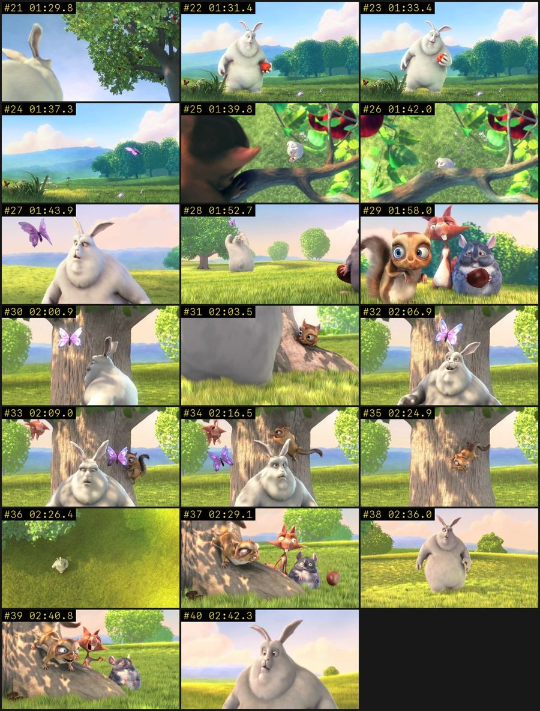
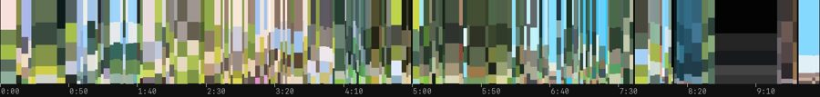

# 9xvision

Video perception for AI agents. Give any agent (Claude Code, Codex, Cursor, anything that speaks MCP or can run a CLI) a video file or URL, and it gets back structured, timestamped evidence instead of a handful of random frames:

- **Screen recordings** (apps, websites): every UI state in order, distinct views, the transition between each (tap, scroll, sheet, swipe), OCR of every screen, stitched full pages, and the flow.
- **Everything else** (films, music videos, talks, demos): shots split at cuts placed on the exact frame *and* content beats (slide changes inside one take), camera motion, palettes, colour script, on-screen text and speech per segment, plus the music: tempo, beat grid, and whether the edit is cut to the beat.
- **Visual search**: find moments by what is in the picture ("motorcycles with glowing wheels at night", "a pie chart"), not only by on-screen text or speech. Runs locally.
- **Capture QA for games, XR and apps**: frame pacing and hitches with timestamps, stereo detection, fast camera turns (comfort), and flashes per second (photosensitivity triage).
- **Drill-down tools**: `zoom` (dense frames of an interval), `frame` (full-res crop), `diff` (what changed between two moments), `search`, `qa`.
- **Long videos and URLs**: watch only `--start 1:02:00 --end 1:05:00` of a three-hour stream; for a URL only that part is downloaded. All times stay in full-video time.

Everything runs locally. There are no API keys and nothing is uploaded.

## What you get

**App and screen recordings:** the flow, step by step, naming where each change happened (`+` = that area gained colour, often a selection; `−` = lost colour):

```
00:09.3  V7 -> V8    [content change at +'Get recommendations' · +'Female']
00:10.4  V8 -> V9    [screen change]
00:17.7  V13 -> V14  [local change at −'Work' · −'Self-Care']
00:18.4  V14 -> V15  [local change at −'Hobbies']
```

Every distinct screen is kept with its text, background and palette, and the list compresses repeats ("same as V9; added: 1986 | 1987 | 1988"). The `+`/`−` labels are a pointer to where to look, not a verdict: on some apps they name the wrong neighbour, so `diff` confirms.

**Everything else:** one labelled cell per shot (or slide / scene change), with camera motion, palette, on-screen text and speech in INDEX.md, plus a colour script of the whole film:




<sub>Big Buck Bunny © Blender Foundation, CC BY 3.0.</sub>

And the sound, for a music video:

```
- music: ~128.5 BPM (pulse clarity 0.385); beat times in `sound.json`
- edit vs music: partly on the beat: 45 of 109 cuts within ±63 ms of a beat (41%; chance would be 27%, p=0.00074)
- sudden rises (drops, hits, entries): 00:06.5 (+6 dB), 00:16.0 (+9.8 dB), 02:16.0 (+9.2 dB)
```

The verdict needs at least 20 cuts and a binomial test against chance; with fewer it says "too few cuts to judge", and a weak pulse (speech, ambience) is flagged as a guess.

**Visual search**, on the same music video:

```
$ 9xvision search "motorcycles with glowing wheels at night"
visual moments: 01:07.0-01:08.3 strong 0.98 · 01:09.0-01:09.5 strong 0.93 · 01:13.5-01:14.0 strong 0.82 · ...
$ 9xvision search "a giraffe"
visual moments: 02:11.5-02:12.0 weak 0.0001 · 01:45.0-01:45.5 weak 0.0001 · 00:55.0-00:55.5 weak 0
  all weak: probably not in the video
```

Scores are SigLIP's calibrated match strength (strong ≥ 0.5, possible ≥ 0.05), so "nothing matches" is a real answer instead of a confident wrong top hit. It is reliable for objects, people, clothing, places and colours, looser for actions ("jumping over a treadmill"), and it cannot do negation ("an empty room") — the tool warns when a query uses it. Every search also returns a contact sheet of its best frames to check.

**Capture QA**, on 40 s of a Half-Life: Alyx playthrough from YouTube (only that window is downloaded):

```
$ 9xvision qa "https://www.youtube.com/watch?v=9M0_SWkRcMk" --start 1:00:00 --end 1:00:40 --fov 108
- 2400 frames at 60 fps capture; mono
- effective fps while moving: median 60.0, 5th percentile 60.0, worst second 59.0
- hitches: 1 (repeated frames while the picture moved), worst 33.3 ms; at 1:00:31.6 (33.3 ms)
- comfort: peak turn 345.21 deg/s; 13 turns above 90.0 deg/s; at 1:00:13.8-1:00:14.3 ...
- flashes: none above 3 per second
```

A hitch is a frame shown again while the picture is changing on both sides: the build missed a refresh. A still scene does not count, and a hold of 250 ms or more is reported separately as a freeze (a stall or a deliberate pause). A game capped below the capture rate (30 in 60) is reported as a cadence, and only holds beyond it count. On a 30 s Overwatch capture it reports exactly the three single-frame repeats found by hand. Side-by-side and top-bottom stereo captures are detected and analysed on the left eye. Turn speed is image rotation: in a headset mirror capture it includes the player's own head turns, so it matters most for artificial turning, cutscenes and trailers. The flash check approximates WCAG 2.3.1 for triage. It is not a certified photosensitivity test.

## Install

```bash
uv tool install git+https://github.com/ASGARD-STUDIOS/9xvision
9xvision setup
```

`setup` plugs 9xvision into every agent it finds: **Claude Code, Codex, Cursor and Claude Desktop**, as an MCP server plus the skill. It also offers the optional pieces: on macOS it installs them with Homebrew (it asks first); on Linux it prints the commands. Those pieces are local speech-to-text (whisper.cpp plus a 466 MB model), tesseract for OCR where Apple Vision is missing, and the visual search model (SigLIP, 210 MB). Then restart the agent and ask it about a video. `9xvision doctor` shows what's installed and connected; `9xvision setup --remove` undoes it. Update later with `uv tool upgrade ninexvision`.

Requires Python 3.11+ and ffmpeg. Tested on macOS (Apple Silicon), Ubuntu x86-64 and Linux ARM64, Python 3.11 to 3.14.

No `uv` yet? `curl -LsSf https://astral.sh/uv/install.sh | sh` (macOS/Linux). Manual routes: Claude Code `/plugin marketplace add ASGARD-STUDIOS/9xvision` then `/plugin install 9xvision@9x`; any MCP client: command `9xvision-mcp`. Any other agent with a shell: put `9xvision` on PATH and give it the text from `9xvision skill`.

## Use

```bash
9xvision watch recording.mp4                          # prints INDEX.md, caches everything (~/.9xvision)
9xvision watch "https://youtu.be/..." --start 12:00 --end 15:00
9xvision watch "https://www.instagram.com/reel/..." --cookies-from-browser chrome   # login-gated sites
9xvision search "a red car at night"                  # on-screen text, speech, and what's in the picture
9xvision zoom <watch> 01:20 01:30 -n 16
9xvision frame <watch> 00:43.2 --crop 0,0.6,1,0.4
9xvision diff <watch> 00:17.0 00:18.3
9xvision qa capture.mp4 --fov 110                     # game / XR / app capture QA
9xvision look <watch> view:12
```

The agent reads `INDEX.md`, looks at the overview contact sheets, and drills down only where a question needs it. Every image an agent is shown is capped at 1568 px on the long edge, so the model never silently downscales it, and its token cost is printed; `frame --crop` gives full resolution.

Processing takes about 20–40 s for a short clip, then about 1.5 s per minute for long videos (a 74-minute keynote: ~100 s), once. After that every question is instant.

URLs go through yt-dlp: YouTube, Vimeo, TikTok, X, Instagram and about 1,800 other sites. Playlists are refused with the list of video URLs, live streams need `--start/--end`, and a failure comes back with the next step (update yt-dlp, use browser cookies, check the URL).

## Benchmark

The same agent (Claude Code headless, Claude Sonnet 5.5) answered the same questions about the same videos **with and without** 9xvision. Both arms had the whole machine: ffmpeg, ffprobe, whisper.cpp, tesseract and python. The kit arm also had `9xvision` (v0.1) and the skill text, and started from an empty cache each run, so its processing time counts. Answers were graded blind by Claude Opus 5.5 against answer keys written and verified from raw frames before the runs. 3–4 runs per cell, October 2026.

| Video | Task | Cost / run | Agent turns | Accuracy without → with | Wall time |
|---|---|---|---|---|---|
| iPhone app onboarding, 97 s | 12 questions | $0.27 → $0.25 | 20 → 15 | 99% → 99% | 84 s → 109 s |
| same recording | full screen-by-screen teardown, 14-point rubric | $0.49 → $0.29 | 27 → 13 | 98% → 96% | 157 s → 128 s |
| music video, 2:37, 110 shots | 12 questions | $0.33 → $0.25 | 28 → 15 | 92% → 98% | 98 s → 99 s |
| keynote segment, 8 min, captions | 12 questions | $0.27 → $0.18 | 21 → 13 | 94% → 100% | 56 s → 68 s |
| full keynote, 74 min, captions | 8 needle questions (on-screen only) | $0.43 → $0.42 | 39 → 28 | 98% → 98% | 156 s → 287 s |
| **all** | | **−22%** | **−38%** | 96% → 98% | |

What this means, without spin:

- **The clear win is cost and effort:** 22% cheaper and 38% fewer agent turns for the same or better answers, and a cache that makes every later question about the same video instant.
- **Accuracy:** a frontier agent with ffmpeg is already a strong video reader. 96% → 98% is within noise at 3–4 runs per cell. The misses the kit avoids are on fast, visual-only detail (0.5 s inserts in a music video, a file path on a slide).
- **Wall time** is often worse on a single question, because the first watch processes the whole video. Use `--start/--end` for a long video when the question is about one stretch.
- It builds things the baseline never does: the UI flow, every screen's copy, palettes, a colour script, stitched pages, beat alignment, capture QA.
- The visual search, sound and capture QA added in v0.3 are not in this benchmark yet. They are tested against known answers (a click track, synthetic captures with injected hitches, answer-keyed shots) in `tests/`.

The answer keys were corrected three times after inspecting failures; each time the key was wrong, not the run, and both arms were re-graded. Harness and grader: `bench/`. The videos and keys are not in the repo: one recording is private and the others are copyrighted.

## How it works

One ffmpeg decode pass at 12 fps (6 fps over an hour) computes per-frame signals: HSV content change, changed-pixel fraction, phase-correlation shift, luma and sharpness. Status bars and home indicators are masked on phone recordings.

- **Screen mode** finds stable UI states with an adaptive quiet threshold and keeps screens that never hold still as "moving" states. It clusters revisits into views on sharper 480 px frames, so toggles and checkmarks count. Transitions are classified by motion and change area, scroll groups are merged, and pages are stitched.
- **Film mode** detects cuts with adaptive thresholds and fades, then re-decodes a short window around each at the native frame rate to place it on the exact frame (102 of 103 cuts on a music video, checked against native frame differences; a dissolve or whip keeps its analysis time). Content beats are added where the picture changes and holds without a cut. Keyframes are the sharpest frame in the middle of each shot.
- **Sound**: spectral-flux onsets, tempo from autocorrelation, Ellis' dynamic-programming beat tracker (beat times within 2 ms on a click track; an outside check found 87–99% of beats within 50 ms of librosa's on pop songs, and Rick Astley at 113.2 BPM vs the published 113), RMS loudness.
- **Visual search**: SigLIP base (Google, Apache-2.0) on onnxruntime, CPU. Frames every 0.5–3 s plus every shot keyframe and screen, embedded once per watch.
- **Capture QA**: every frame at its native rate, small and grey; repeated frames, phase-correlation catch-up, packet timestamps, luminance swings.
- **Text**: Apple Vision OCR on macOS (in a watchdog process), tesseract elsewhere.
- **Speech**: captions first (yt-dlp or a sidecar `.vtt`), then whisper.cpp locally.

## Limits

- The screen-mode `+`/`−` labels are a colour heuristic: right on a journaling app's onboarding toggles, wrong on some iOS settings sheets. Confirm with `diff`.
- Scroll stitching is experimental and only runs when consecutive states share content.
- Sound covers tempo, beats, loudness and speech. It does not describe instruments, mood or sound design.
- OCR quality follows the source resolution; on 720p screen shares, small UI text needs `frame --crop`. Stylised titles are often missed.
- Visual search is as good as SigLIP base: strong on objects, scenes and colours; looser on actions; no negation, counting, fine text or small details.
- Capture QA works from the video alone, so it sees what the viewer saw: a hitch hidden by the capture tool, or added by its encoder, is invisible or indistinguishable. Engine frame-time logs are the ground truth when you have them.

## License

MIT © Koto Murai
